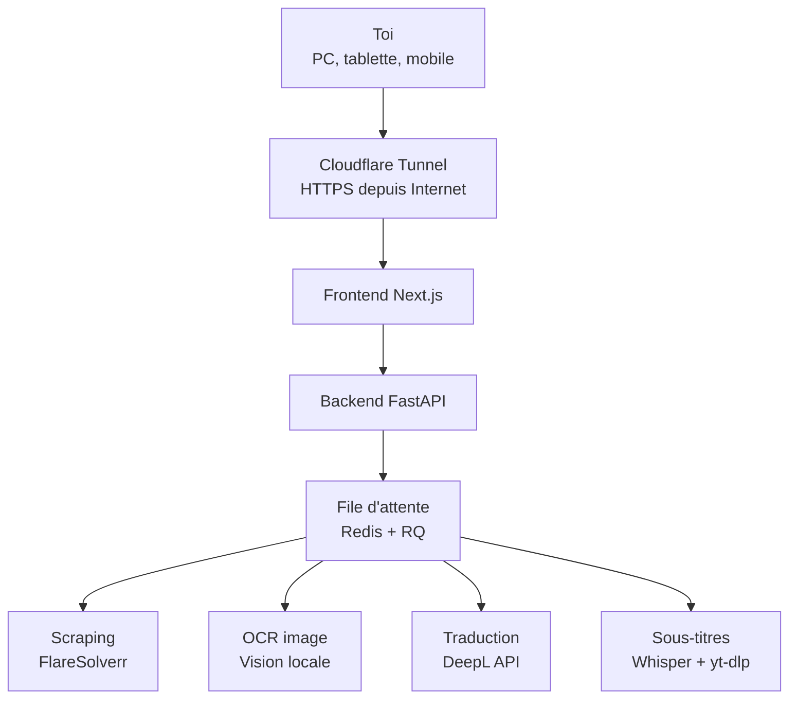

# Architecture

## Décisions prises

- **Traduction unifiée** sur l'API DeepL officielle (SDK Python), plus de
  `deeplx`/Node.js.
- **Génération docx** du script scrapé portée en Python pur (plus de
  dépendance Node.js).
- **OCR image** : à trancher entre modèle de vision local (Ollama) et API
  Claude en secours, après tests sur des images réelles.
- **Sous-titres** : `yt-dlp` ajouté pour le téléchargement direct depuis un
  lien YouTube ; la logique Whisper/alignement existante est réutilisée
  telle quelle (pas réécrite) pour limiter le risque de régression.
- **Accès distant** : Cloudflare Tunnel (pas d'ouverture de port), avec
  authentification avant exposition sur Internet.
- L'appli ne reste accessible que lorsque le PC (serveur) est allumé —
  accepté comme contrainte pour l'instant.

## Roadmap

- [x] Phase 1 — Backend FastAPI unifié (scraping, traduction DeepL,
      orchestration sous-titres), sans n8n ni Node.js
- [x] Phase 2 — File d'attente Redis/RQ + logs en direct par WebSocket
      (jobs asynchrones pour scraping, traduction et sous-titres)
- [ ] Phase 3 — Frontend Next.js + Tailwind/shadcn
- [ ] Phase 4 — Cloudflare Tunnel + authentification
- [ ] Phase 5 — Choix et branchement du modèle de vision (OCR)
